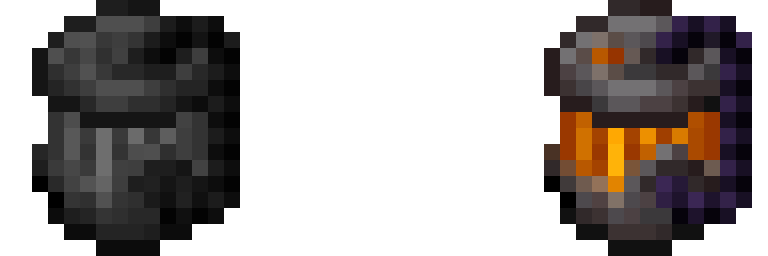

# Towns and Kingdoms - Workshop 0.2.1

Minecraft 1.21.1 / NeoForge 21.1.219 or newer (21.1.x) / Java 21.
Install the JAR on the server and all clients. No other mods required.

## Quest Projector

A placeable projector using the supplied Polaroid Studio / KidTokio model and
original animated texture. Place it and right-click: all setup uses the screen.

- **Quests:** search by quest/chapter name and select up to five quests. The
  hologram shows titles, task item icons, required amounts and live progress for
  the viewing player's FTB Quests team. Hidden quests/details stay hidden.
  Long lists automatically turn pages every eight seconds, repeating the quest
  heading on continued pages. The arrow beside a quest opens its FTB details.
- **Image:** paste a direct HTTP/HTTPS image link and press Preview / reload.
  PNG, JPG and GIF are supported (first frame for GIF). Aspect ratio is preserved.
- **Formatted text:** multiline text with Minecraft `&0`–`&f` colors,
  `&#RRGGBB`, `&l` bold, `&o` italic, `&n` underline, `&m` strike-through,
  `&r` reset, plus `**bold**` and `*italic*`. Literal `\n` also creates a newline.
- **Appearance:** separate six-digit hex inputs (`#RRGGBB`, or without `#`) with
  color swatches for the model's tintable parts, projection accent, default text,
  completed tasks and backdrop. The original untinted metal parts stay neutral.
  Each placed projector stores its own palette; configured drops use its body tint.
  Inline text formatting still overrides the default text color.
- Gentle bobbing moves the entire projected field together (text, task icons,
  images and backdrop), ±0.035 blocks over a seven-second cycle. Toggle it on/off
  in Appearance. It is enabled by default, including on older projector settings.
  The supplied two-frame texture animation remains unchanged; each frame lasts
  ten ticks (half a second). The block model itself has no moving parts.
- Adjustable projection width (1–8 blocks), elevation (0.5–6 blocks), backdrop
  and optional face-player orientation. Otherwise it faces its placement direction.
- Only the placer or an operator can change settings. Other players can view
  the selection and open linked quests. Claim interaction denial is respected.
- Breaking the projector preserves its display settings on the dropped item;
  placing it assigns ownership to the new placer.

Crafting pattern (I = iron ingot, G = glass, A = amethyst shard, R = redstone):

| | | |
|---|---|---|
| I | G | I |
| A | R | A |
| I | I | I |

FTB Quests is optional: required only for quest mode. The bridge targets its
Minecraft 1.21.1 / 2101 API and reads the already synchronized local team data.
It does not submit tasks, take items, change progression or auto-claim rewards.
Use the normal quest details for those actions. Your KubeJS items stay intact.

Images are fetched on clients with two bounded background workers, a 32-image
session cache, an 8 MB transfer cap and a 4096-pixel / 8-megapixel decode cap.
Public internet hosts only; redirects receive the same address validation.
A failed image displays a status message and can be retried with Preview / reload.
Images and formatting do not require FTB Quests.

Stable registry namespace: `tnkcore`. Projector item/block: `tnkcore:quest_projector`.
Existing Spawner Cage IDs and saved data are unchanged.
Existing 0.2.0 projector settings load with the default purple palette.
Install matching Workshop 0.2.1 on the server and clients: the projector settings
packet now carries colors and the animation toggle (protocol version 2).

## Spawner Cage

Empty: dull grey and static. Filled: the original animated orange flame.

Item ID: `tnkcore:spawner_core`

`/give @s tnkcore:spawner_core`

Also available in the Towns and Kingdoms - Workshop creative tab.
No recipe is included. Add a late-game recipe or quest reward in the modpack.

1. Right-click a regular monster spawner with an empty core to capture it.
2. Right-click a block with the filled core to place the spawner at the target face.
3. The core is consumed after successful placement, including in Creative.

Filled cages show the captured mob, additional spawn-pool types, spawn count,
delay range, activation range and spawn range from the saved spawner data.

One core carries one spawner. No durability, repairs or reusable remainder.
The empty cage uses a static, dull grey version of the supplied texture.
A filled cage switches to the original animated orange texture.
The original PNG and animation metadata are included unchanged for the filled state.
The registry ID remains `tnkcore:spawner_core` for existing worlds and scripts.

Full spawner block-entity data is retained, including spawn potentials, delays,
entity data, persistent mod data and attachments. This is intended to preserve
Apotheosis settings on vanilla spawner blocks; no direct Apotheosis dependency.
Custom spawner blocks and trial spawners are outside this first feature's scope.

Capture checks NeoForge's block-break protection event. Both capture and placement
participate in NeoForge's standard item-use snapshot transaction, allowing claim
mods to cancel and roll back the operation. Failed placement keeps the filled core.
No XP or spawner item drops are generated by capture.

## Development

`./gradlew build`

`./gradlew runGameTestServer`

GameTests cover Survival/Creative data round trips, blocked placement and canceled
break/place events. Test classes/templates are excluded from the release JAR.

The source layout keeps feature classes separate so more Core features can be
added under the same stable `tnkcore` namespace.
